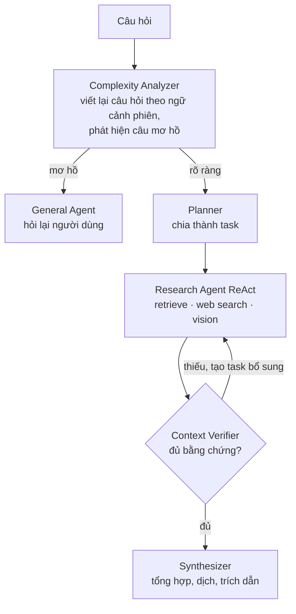

# 📄 PaperInteligentAI: Multi-Agent RAG cho bài báo khoa học

Hệ thống hỏi đáp trên bài báo khoa học (PDF). Hệ thống đọc cả **bảng, công thức và hình**, trả lời kèm **trích dẫn nguồn [1], [2]**, nhớ ngữ cảnh hội thoại và tự hỏi lại khi câu hỏi mơ hồ. Mô hình chạy cục bộ bằng **Ollama**, các agent được điều phối bằng **LangGraph**, backend dùng **FastAPI** và lưu trữ trên **PostgreSQL + pgvector**.

Điểm chính: hệ thống được **đánh giá bằng bộ test có đáp án kiểm chứng** chứ không chỉ dựa vào demo. Khi có câu trả lời sai, lỗi được truy đến tận nguyên nhân gốc trong log (xem phần [Debug: câu Table 2](#-debug-câu-table-2-010)).

---

## Kiến trúc



| Thành phần | Công nghệ |
|---|---|
| Đọc PDF | `marker-pdf`. Bảng, công thức và code được tách thành ảnh, phần text trích được lưu kèm (`content.md`) |
| Chunking | Chia theo heading, tách section dài, **mỗi bảng là một chunk riêng** |
| Retrieval | Hybrid search (pgvector cosine + keyword KeyBERT) → rerank bằng cross-encoder `ms-marco-MiniLM-L-6-v2` |
| Embedding | `sentence-transformers/all-MiniLM-L6-v2` (chạy local) |
| LLM | Ollama (`qwen2.5:7b-instruct`) cho agent; Groq cho synthesizer (nếu có key) |
| Vision | Ollama `minicpm-v` để đọc hình khi cần |
| Bộ nhớ | Tóm tắt phiên lưu trong bảng `summary_session` (Postgres); câu hỏi tiếp theo được viết lại kèm ngữ cảnh |
| Backend / UI | FastAPI + Streamlit (UI chỉ gọi qua API) |

---

## 🔍 Debug: câu Table 2 (0/10)

Trong bản benchmark thử nghiệm đầu tiên (4 câu), câu hỏi về **Bảng 2** của bài ViT bị chấm 0/10, agent trả lời "không tìm thấy thông tin". Ban đầu mình nghĩ lỗi là do không đọc được bảng. Khi đọc lại log, mình thấy **retrieval hoàn toàn đúng**: chunk mục 4.2 được trả về kèm khối `[RELATED TABLE]` chứa đủ `0.68k`, `9.9k`, `87.76`, `87.54`. Câu trả lời vẫn sai vì 3 lỗi nối tiếp nhau:

| # | Lỗi | Hậu quả | Cách sửa |
|---|---|---|---|
| 1 | Model local không theo format ReAct, agent "force end" và lấy **đoạn văn tự do** của model làm kết quả | Kết quả task là một bài tổng quan chung chung về ViT, bảng vừa retrieve bị bỏ mất | Khi phải force end, chuyển **bằng chứng đã retrieve** đi tiếp (`forced_answer_from_evidence`) |
| 2 | Verifier chỉ đọc bản tóm tắt của agent, không đọc bằng chứng gốc | Verifier kết luận "thiếu số liệu", tạo task mới 3 lần và lặp lại đúng lỗi trên | Verifier nhận thêm `RAW RETRIEVED EVIDENCE` |
| 3 | Synthesizer cắt mỗi document ở **1.000 ký tự**, trong khi bảng nằm cuối chunk dài khoảng 3.250 ký tự | Số liệu không bao giờ tới được LLM cuối | Chỉ cắt phần văn xuôi, giữ nguyên khối bảng/hình, có giới hạn tổng (`format_reference_docs`) |

Các cải tiến khác:
- **Mỗi bảng thành một chunk riêng** (`Table N: caption` + bảng markdown), nên số liệu được embed và tìm được bằng keyword.
- **Tách section dài** theo đoạn văn (tối đa 1.500 ký tự). Model embedding chỉ đọc khoảng 256 token, nên trước đây section dài chỉ được embed phần đầu.
- **Embedding có thêm heading path** của section.
- **Re-chunk xoá chunk cũ** trước khi ghi lại.
- **Bắt `Final Answer:` nhiều dòng.** Regex cũ chỉ lấy dòng đầu.

Các lỗi trên được tái hiện bằng unit test chạy không cần DB/LLM: `pytest tests/`.

---

## 📏 Đánh giá

### Bộ test: `eval/vit_qa.json` (28 câu)

| Loại | Số câu | Ví dụ |
|---|---|---|
| text | 10 | optimizer / batch size, kích thước dataset, self-supervision |
| table | 10 | số liệu trong Bảng 1–4 và bảng ablation position embedding |
| appendix | 3 | SGD vs Adam cho ResNet, warmup, dev split |
| multi-hop | 2 | kết hợp Bảng 1 và Bảng 2 |
| unanswerable | 3 | hỏi những gì bài báo **không có** (COCO mAP, chi phí USD...). Agent phải trả lời là không tìm thấy |

Mọi đáp án đều đã được đối chiếu với nội dung bài báo.

### Cách chấm

- **Correct:** câu trả lời có đủ mọi *key fact* (số liệu/thuật ngữ, chấp nhận nhiều cách viết như `0.68k` / `0,68k`). Với câu unanswerable, agent phải từ chối trả lời. Phần này chấm **tự động, không dùng LLM**.
- **Evidence hit:** retrieval có trả về đoạn chứa đáp án không. Tiêu chí này tách lỗi *tìm kiếm* khỏi lỗi *suy luận/tổng hợp*.
- **LLM judge (Groq, 0–10):** chỉ số phụ. Nếu gọi API lỗi thì ghi nhận là lỗi, không gán điểm giả.

### Chạy và so sánh

Script eval chỉ gọi HTTP API, nên dùng được với cả code cũ lẫn code mới:

```bash
# A) Baseline: code cũ + chunk cũ
git checkout master
git checkout feat/rag-eval-fixes -- eval        # chỉ lấy thư mục eval sang
#   (khởi động lại uvicorn)
python -m eval.run_eval --label A_baseline

# B) Code mới + chunk cũ
git checkout feat/rag-eval-fixes
#   (khởi động lại uvicorn)
python -m eval.run_eval --label B_agent_fixes

# C) Code mới + re-chunk
curl -X POST http://127.0.0.1:8000/chunk/<doc_id>
python -m eval.run_eval --label C_full

python -m eval.compare eval/results/A_baseline.json eval/results/C_full.json
```

Báo cáo (Markdown + JSON) được lưu ở `eval/results/`.

---

## Cài đặt và khởi chạy

### Yêu cầu
- Python 3.10+
- Docker (PostgreSQL + pgvector)
- Ollama với `qwen2.5:7b-instruct-q4_K_M` (và `minicpm-v` nếu dùng vision)

### 1. Database
```bash
docker compose up -d
```

### 2. Thư viện
```bash
python -m venv venv
venv\Scripts\activate          # Windows
source venv/bin/activate       # Linux/macOS
pip install -r requirements.txt
```

### 3. File `.env`
```env
DB_HOST=localhost
DB_PORT=5432
DB_NAME=paper_intel
DB_USER=postgres
DB_PASSWORD=postgres
OLLAMA_BASE_URL=http://localhost:11434
# Dùng Groq cho synthesizer, Ragas và LLM judge
GROQ_API_KEY=your_groq_api_key
```

### 4. Backend (FastAPI)
```bash
python -m uvicorn app.api.main:app --host 127.0.0.1 --port 8000
```
Bảng dữ liệu được tạo tự động ở lần chạy đầu.

### 5. Giao diện (Streamlit)
```bash
python -m streamlit run app/ui.py
```

### API chính

| Endpoint | Chức năng |
|---|---|
| `POST /upload-pdf` | Upload PDF |
| `POST /ingest/{doc_id}` | PDF → Markdown → chunk → embedding |
| `POST /chunk/{doc_id}` | Chunk lại tài liệu (xoá chunk cũ) |
| `POST /retrieve` | Hybrid search |
| `POST /agent/query` | Hỏi đáp qua toàn bộ luồng agent |
| `POST /evaluate-memory` | Đánh giá Ragas trên lịch sử hỏi đáp lưu trong DB |

---

## Cấu trúc thư mục

```
app/
├── agent/       analyzer, planner, research_agent (ReAct), verifier, synthesizer, agent_loop (LangGraph)
├── api/         FastAPI
├── llm/         Ollama / Groq providers, embedding, reranker
├── pipelines/   ingest, pdf2markdown, chunking, retrieve
├── services/    pdf_handler (marker), chunker
├── tools/       retrieve_tool, web_search_tool, vision_tool
└── utils/       db, evidence (ngân sách ngữ cảnh), logger, storage
eval/            Bộ 28 câu + script chấm + so sánh
tests/           Unit test (không cần DB/LLM)
```
